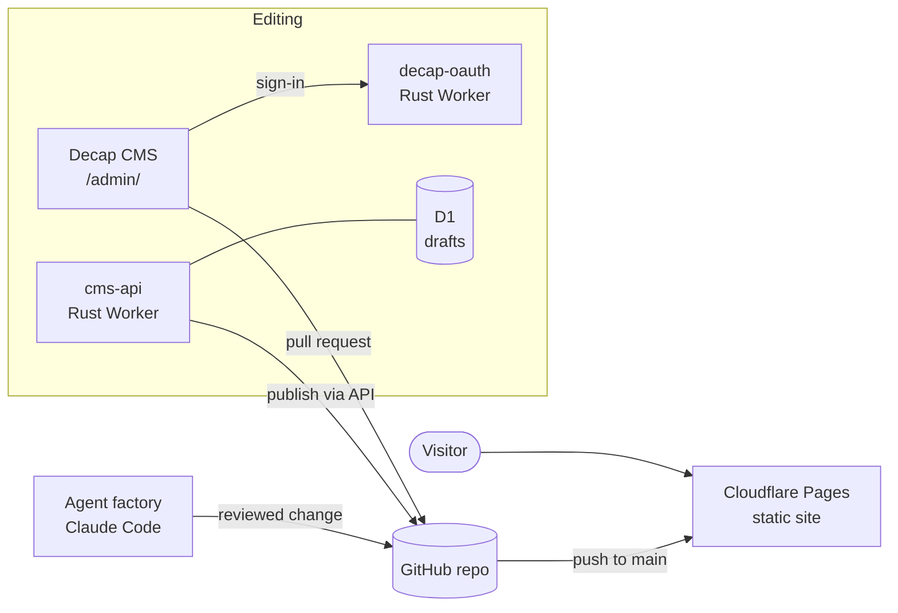

# Nows: portfolio, CMS and agent factory

My portfolio and writing, built while learning Rust. It costs nothing to run, has two editors I can write in from a browser, and every change to it goes through a line of AI agents that plan, build, review and approve the work.

- **The site** is static HTML built by [Zola](https://www.getzola.org/) and served by Cloudflare Pages. Its look comes from a carbon-copy receipt book: the hero is one donation recorded by three systems, stamped "Reconciled" when they match.
- **Stage A editor**: [Decap CMS](https://decapcms.org/) in the browser, signing in through a GitHub OAuth worker written in Rust.
- **Stage B editor**: my own CMS, a Rust Cloudflare Worker with drafts in D1 that publishes straight into this repository.
- **The factory**: Claude Code agents for planning, building, UI/UX review, security checking and approval, with quality gates, a build seal, an andon cord and a live dashboard, all driven by a Rust CLI.

## How it fits together



Git is the single record of what's public. The editors and the agents all end in a commit; Cloudflare Pages rebuilds the site from it.

## Quick start

On Windows 11, in PowerShell, from this folder:

```powershell
powershell -ExecutionPolicy Bypass -File scripts\setup.ps1
zola --root site serve
```

Then open http://127.0.0.1:1111. macOS and Linux: `bash scripts/setup.sh`.

The full path to a live site, both editors and the first factory order: **[docs/setup.md](docs/setup.md)**.

## The factory

```
/factory Add a "Back to all writing" link at the end of every article.
```

| Station | Agent | Job |
|---|---|---|
| Plan | `planner` | File-by-file plan with testable acceptance checks |
| Build | `builder` | Implements, runs every check until green |
| Design review | `ui-ux-reviewer` | Screenshots in both themes and two widths, WCAG 2.2 AA scan, design-system review |
| Security check | `security-checker` | Secrets, XSS, CSP, auth, SQL, dependencies, guardrails |
| Approval | `approver` | Re-runs everything itself, traces the change to the request, writes a lesson |

Reviews that find real problems send the work back to Build. Critical findings stop the line. Approval is refused if the code changed after it was built. Run `factory serve` to watch the line at http://127.0.0.1:4600. More in **[docs/factory.md](docs/factory.md)**.

## What's where

| Path | What |
|---|---|
| `site/` | The Zola site: content, templates, styles, static files, security headers |
| `crates/cms-core/` | The rules everything shares: validation, slugs, front matter, sessions, safe preview |
| `workers/decap-oauth/` | GitHub sign-in for Decap CMS |
| `workers/cms-api/` | The stage B CMS: API, admin page, D1 migrations |
| `tools/newpost/` | `newpost "Title"` starts an article; `newpost --check` checks them all |
| `tools/factory/` | The factory CLI, hooks and dashboard |
| `tools/shots/` | Screenshots and accessibility scans of the built site |
| `.claude/` | Agents, skills, rules, settings and agent memory for Claude Code |
| `.factory/` | The production board and the line's lessons |
| `docs/` | Guides |

## Docs

- [Setup on Windows 11](docs/setup.md)
- [Writing and the two editors](docs/cms.md)
- [The factory](docs/factory.md)
- [Design system](docs/design-system.md)
- [Security](docs/security.md)
- [Learning Rust with this repo](docs/learning-rust.md)

## Running costs

| Service | Free plan | This site's use |
|---|---|---|
| Cloudflare Pages | Unlimited requests and bandwidth, 500 builds a month | One build per push |
| Cloudflare Workers | 100,000 requests a day | Sign-ins and editing |
| Cloudflare D1 | 5 GB, 5 million rows read and 100,000 written a day | Drafts |
| GitHub | Public repositories and Actions minutes | Code, content, CI |

## Licence

Code under the [MIT licence](LICENSE). Writing and images © Nows. Fonts under the SIL Open Font License.
