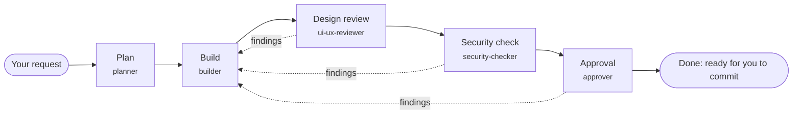

# The factory

Changes to this site are made on a small production line of Claude Code agents, run the way a lean factory runs: work moves through fixed stations, each station inspects what it receives, defects stop the line instead of travelling downstream, and every defect leaves a lesson that improves the process.



## Running it

| You type | What happens |
|---|---|
| `/factory <what to change>` | Opens a work order and runs it through every station |
| `/factory-resume WO-0003` | Continues an order from where it stopped |
| `/release` | Checks everything and walks you through deploying |
| `/kaizen` | Reviews how the line has been doing and proposes improvements |

The main Claude Code session acts as the **line supervisor**: it opens the order, hands it to each station's agent in turn, reads the board after each one, and asks you when a decision is needed. The agents do the work.

Watch it live in a second terminal:

```powershell
factory serve
```

Then open http://127.0.0.1:4600. The board shows each order as a card in its station's column, with a moving stripe while an agent works on it. Click a card for its reports, findings and history.

## The stations

| Station | Agent | What it does | What it may change |
|---|---|---|---|
| Plan | `planner` | Reads the request and the code; writes a file-by-file plan with testable acceptance checks; asks you when the request is ambiguous | Nothing in the project |
| Build | `builder` | Implements the plan; runs fmt, clippy, tests, the Zola build and content checks; fixes findings on rework | Project files, except the factory board, the agent definitions, settings and secrets |
| Design review | `ui-ux-reviewer` | Screenshots affected pages (phone and laptop, light and dark), runs an accessibility scan, checks the design system and copy | Nothing in the project |
| Security check | `security-checker` | Hunts secrets, XSS, header and CSP gaps, auth and session weaknesses, SQL injection, risky dependencies, weakened guardrails | Nothing in the project |
| Approval | `approver` | Re-runs every check itself, traces the change back to the request, approves or sends back, and writes a lesson | Nothing in the project |

Each agent lives in `.claude/agents/<name>.md`, with its steps, its report template and the skills it loads. Skills in `.claude/skills/` hold the know-how they share: `factory-protocol`, `zola-site`, `design-system`, `rust-workers`, `cms-content`, `ui-ux-review`, `security-review`.

## Quality built in

**Findings.** Reviewers log each problem with a severity. Low is polish and passes. Medium and high block approval. Critical stops the line.

**Rework.** A review that finds a medium-or-worse problem sends the order back to Build. Earlier reports are archived (`design.rework-1.md`) so every station reviews the new code fresh.

**Andon.** The cord any station can pull. A critical finding pulls it automatically, and so does a fourth rework loop. While it is pulled, the CLI refuses every move, the status line turns red, and every new session opens with a warning. Only you clear it, once you've decided what happens:

```powershell
factory andon --clear --note "Rotated the token; carry on"
```

**Build seal.** When the builder passes, the CLI fingerprints every file in the repository. Approval re-checks the fingerprint: if anything changed after the build (a reviewer "fixing" something on the side, an edit you forgot), approval is refused. This is the line's poka-yoke: a mistake-proofing device, so a reviewed change is exactly the change that was built.

**Guards.** Reviewers can't edit project files: a hook (`factory guard`) blocks their Write and Edit calls outside their own memory folder. The builder can't edit the board, the agents, the settings or `.dev.vars`. Project settings deny reading secrets, and ask you before any commit, push, deploy or deletion.

**Gates.** `factory verify WO-0003` shows the approval checklist at any time: every station passed in this cycle with its report, no open findings of medium or worse, the line running, the seal intact.

## Memory

The line remembers at three levels:

| Level | Where | Written by | Read by |
|---|---|---|---|
| Standard work | `CLAUDE.md`, `.claude/skills/`, `.claude/rules/` | You (or a kaizen order) | Everyone, every run |
| Station experience | `.claude/agent-memory/<agent>/MEMORY.md` | Each agent, about its own station | That agent, every run |
| The line's lessons | `.factory/memory/lessons.md` | The approver, after rework or findings | The planner and reviewers; the latest five open every session |

All three are plain files in the repository, so they're versioned with the code and you can read, edit or prune them. `/kaizen` turns repeated lessons into changes to the standard work.

## The numbers on the dashboard

- **First-pass yield**: share of finished orders that never went back to Build. The line's main quality measure.
- **Average lead time**: from opening an order to approval.
- **Line stops**: how often the andon was pulled.
- **Open findings**: by severity, across orders still on the line.

## The CLI for you

The agents use the same commands; these are the ones you'll reach for:

| Command | Use |
|---|---|
| `factory status` / `factory status --all` | Orders on the line / including closed ones |
| `factory show WO-0003` | One order: station, seal, findings, history |
| `factory verify WO-0003` | The approval gates, checked without changing anything |
| `factory andon --clear --note "..."` | Restart the line |
| `factory scrap WO-0003 --reason "..."` | Drop an order |
| `factory note WO-0003 "..."` | Add a note to an order's history |
| `factory learn "..."` | Add a lesson by hand |
| `factory serve [--port 4600]` | The dashboard |

`factory --help` lists everything. The board itself is `.factory/board.json`: commit it with your changes, so the history of the line is part of the repository.

## Tuning the line

- **Cost.** An order runs five agents, each reading the code. On a Pro plan, use the line for changes worth reviewing, and ask Claude directly for small fixes and questions. To save usage, set `model: sonnet` (or `haiku`) in the front matter of the reviewers in `.claude/agents/`, and keep the planner and builder on your default.
- **Stricter or looser.** The rework limit is `max_rework` in `.factory/board.json`. Severity rules live in the `factory-protocol` skill; review checklists in `ui-ux-review` and `security-review`.
- **A new check.** Add it to the relevant skill's checklist, or better, make it a test or a CI step so it runs every time.
- **A new station** (say, performance or SEO) means a new agent file, a new skill, and a new `Station` in `tools/factory/src/board.rs`: a good Rust exercise, done through the line itself.

## When something goes wrong

| Symptom | Fix |
|---|---|
| `factory: not set up` in the status line | Run `factory init` in the project folder |
| "Blocked: this station reviews and must not edit..." | Working as intended: a reviewer tried to edit; it should log a finding instead |
| Approval refused: "Code is unchanged since the build passed" unchecked | Something changed after the build. `git status` shows what; send the order back with `factory fail` so the builder owns the change |
| An agent ended without passing or failing | `/factory-resume WO-xxxx` dispatches it again |
| The board looks wrong | `.factory/board.json` is versioned: `git diff .factory/board.json` shows what changed, `git checkout -- .factory/board.json` restores it |
